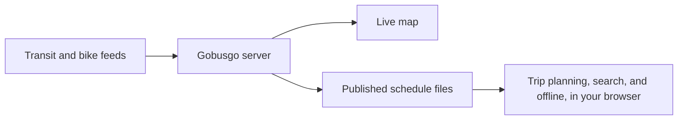

# Gobusgo

Every bus, train, ferry, bike, and scooter in the Puget Sound, moving on one map, live. Gobusgo plans your trip on your own phone, keeps working when the signal dies in a tunnel, and never once asks where you are. Other transit apps exist. We've seen them. We built this anyway.

## A short lesson

> *Gee, the bus on my map just jumped three blocks. Is it a teleporting bus?*
>
> Hardly. Most maps draw a vehicle where it was at its last report and leave it there to sulk until the next one. Gobusgo predicts each vehicle along its trip's actual road path between reports, so it glides down the street the way a bus does. It even draws a dashed tie back to the last real report, so you can see how much is prediction and how much is fact.

> *So how do I know if a bus is real or just wishful thinking?*
>
> Every marker wears its honesty in its color: live, stale, schedule only, or no report time. A map that hides how old its data is, is a map that hopes you won't ask.

> *Okay, but when I plan a trip, doesn't the app have to send my location to some big computer?*
>
> Most do. Gobusgo plans the whole trip in your browser. It downloads the published schedule in hourly slices, and runs the search right there on your phone: once the slices are in hand, a typical answer takes about 30 milliseconds. Your position, your destination, and whatever you typed into the search box never leave the device. The server learns nothing, which is precisely how much we'd like it to know.

> *What about the tunnel? My map always dies in the tunnel.*
>
> Ah, the tunnel. While you browse, Gobusgo quietly saves the schedules of today and tomorrow, the route lines, and a directory of places. Lose the signal and the page keeps going: scheduled vehicles keep moving along their paths, stops keep showing their next arrivals, and the trip planner keeps planning. Turn on one setting and it saves the map itself, too.

> *Wow. Can I search for "4th & Pike" or my friend's address?*
>
> Places, street addresses, and intersections, all searched in your browser. An address the county never listed is placed between its neighbors on the same side of the street, typically within about 11 meters. Show me another map that does its homework like that. I'll wait.

> *Does it count me? Like, follow me around?*
>
> It counts visits so we know if anyone shows up, and nothing more: no IP address, no cookie, no identifier. Two visits by the same person cannot be told apart. The full list of what it records is in the app's Settings tab, in plain sentences.

> *Can my AI assistant use it?*
>
> Naturally. Gobusgo speaks the Model Context Protocol, so an assistant can look up arrivals, alerts, routes, and vehicles, and plan a trip with the same in-browser planner. Quite civilized.

## What's in the box



The server fetches, stores, and publishes. The browser does the thinking. Read how:

- [How the algorithms work](docs/algorithms.md): trip planning, vehicle motion, search, and offline service.
- [How the server works](docs/server.md): fetching on demand, the data flow, the endpoints, and the AI assistant tools.
- [Development](docs/development.md): setup, configuration, tests, Docker, and building the map and search files.

## Running locally against production

A fresh local server knows nothing yet: it has no routing schedule until it has fetched every route, and no places, address, or intersection files until someone builds them. So point the page at production's published files instead, and let your server fetch the live vehicles, arrivals, and alerts itself.

You need the toolchain from [Development](docs/development.md#setup), a basemap in `data/basemap` ([building one](docs/development.md#basemap)), and a OneBusAway API key of your own. Use your own key, never production's, so a local run takes nothing from production's rate limit.

```sh
cp .env.example .env          # then fill in ONEBUSAWAY_BASE_URL and ONEBUSAWAY_API_KEY
set -a; source .env; set +a
mix assets.build
GOBUSGO_FILE_ORIGIN=https://<production site> GOBUSGO_HTTP_HOST=0.0.0.0 mix phx.server
```

Open <http://localhost:4000/vehicles>, or the computer's address from a phone on the same network. `GOBUSGO_FILE_ORIGIN` sends the page's fetches of the routing, trip path, places, address, and intersection files to that origin; everything else comes from your machine, and your server writes nothing anywhere but your own `data/` directory.

## Credits and licenses

Gobusgo is open source under the [MIT License](LICENSE), copyright (c) 2026 Harriet Waters. It is an independent project, and no transit agency or operator endorses it.

The data and the code it ships carry their own terms:

| What | Source | Terms |
| --- | --- | --- |
| Transit schedules, vehicles, arrivals, and alerts | The transit agencies of the Puget Sound region, served by the [OneBusAway API](https://developer.onebusaway.org/api/where/methods) | Provided "as is" under Sound Transit's [Transit Data Terms of Use](https://www.soundtransit.org/help-contacts/business-information/open-transit-data-otd/transit-data-terms-use) |
| Shared bikes and scooters | Lime Seattle's public GBFS feed | Lime's Public GBFS Terms, <https://www.li.me/gbfs-terms> |
| Basemap, places, and intersections | © [OpenStreetMap contributors](https://www.openstreetmap.org/copyright), basemap built by [Protomaps](https://protomaps.com) | [Open Database License 1.0](https://opendatacommons.org/licenses/odbl/1-0/); the places and intersection files are derivative databases offered to everyone under the same license |
| Address points | King, Pierce, and Snohomish counties | [King County GIS terms](https://kingcounty.gov/en/dept/kcit/data-information-services/gis-center/about/terms-conditions-copyrights), [Pierce County GIS Data Terms of Use](https://matterhorn.piercecountywa.gov/Disclaimer/PierceCountyGISDataTermsofUse.pdf), and Snohomish County's layer disclaimer |
| MapLibre GL JS, PMTiles, Protomaps basemap styles | Vendored front-end packages | BSD-3-Clause |
| fflate | Vendored front-end package | MIT |
| Noto Sans fonts and Protomaps map icons | Vendored basemap assets | SIL Open Font License 1.1 for the fonts, MIT for the icons |
| Phoenix and Phoenix LiveView | Server dependencies | MIT |

Anyone you hand the transit data to gets the Transit Data Terms of Use along with it. The app's Settings tab carries the same credits, the full county disclaimers, and the version of every package it ships.
