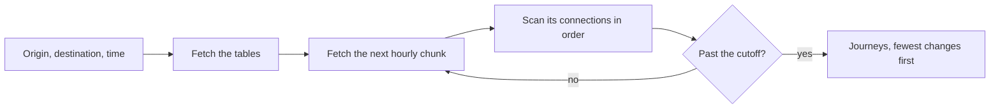

# How the algorithms work

Gobusgo's server fetches and publishes; the browser does the reasoning. Everything on this page runs on the rider's device, which is why a rider's position, destination, and search text never reach the server. The browser's reasoning lives in `assets/js/core/`, a set of pure modules that take values and return values and do no IO, so the same logic can run in a native app.

## Trip planning

> *How does a phone plan a trip across four transit agencies without a server?*
>
> With a connection scan. It reads departures in time order, once, and keeps the earliest arrival at every stop. Simple enough that a phone does it in a blink.

### The schedule files

For each service date the server publishes a routing snapshot: binary tables of stops, trips, transfers, and stop positions, and the connections themselves. A connection is one hop of one trip, from one stop to the next, with a departure and an arrival time. Connections are sorted by departure and cut into hourly chunks, so a query fetches only the hours it needs.

A snapshot covers its date's trips and the previous date's trips still running after midnight, so a 1 a.m. query finds the night owl that left at 11:40 p.m.

### The scan

The scan starts at the departure time and walks the connections forward. A connection is usable if its departure stop has already been reached in time, either by riding there or by walking there. Reaching a stop earlier than ever before records the arrival and the connection that did it; following those records backward gives the journey.

The browser keeps asking for chunks until it passes a cutoff: the earliest arrival found plus 45 minutes. Within that window it keeps every journey that is the best for its number of changes, so a rider sees both the fastest trip and the one with fewer transfers. "Arrive by" runs the same scan backward from the arrival time.

A query that runs off the end of a service date continues into the next date's snapshot, so a late-night search finds the first morning trip.

### Walking and transfers

The source schedule has no transfers, so the server derives them:

- Changing trips at one stop takes at least 120 seconds.
- Two stops at most 400 meters apart in a straight line are joined by a walk at 1.2 meters per second, and each stop keeps its 64 nearest walks.

The browser applies the same rules to walk from the rider's position to the nearest stops, and from the last stop to a destination that is a place, an address, or an intersection rather than a stop. The rules travel in the snapshot's manifest, so the server and the browser can never disagree about them.

### How fast

Over the full network on 2026-11-10 (12,892 stops, 675,530 connections in 28 chunks), a typical stop-to-stop query fetched 4 chunks and answered in about 29 ms from files on disk. A destination no journey reaches costs the most, because the scan reads every chunk after the departure looking for one.

## Vehicle motion

> *But the bus only reports every so often. Why does it move smoothly?*
>
> Because we know where it's going. A bus on a trip follows that trip's path, and the schedule says when it should be where.

Between reports, each vehicle is predicted along the road path of its trip. The page reads the path from the trip path files the server publishes beside each snapshot, fetching only the files for the routes on screen.

- A vehicle on a trip moves along its path from its last report, at a pace that agrees with its schedule and its lateness.
- A vehicle that has stood within 10 meters of one spot is treated as laying over: it holds until its trip's scheduled departure, or 30 seconds after it stopped, and stays at its report once it has stood 90 seconds.
- A stale vehicle, or one on no trip, stands at its last report rather than wander off on a guess.
- A predicted vehicle shows a ring at its last report and a dashed line along the path to where it is drawn, so the prediction is never mistaken for a fact.

Smooth motion is drawn on a canvas over the map, only within a band of zoom, below a count of vehicles in view, on a visible page, and never under the reduced-motion setting. Otherwise markers step from position to position.

### Marker colors

Every marker is drawn in its route's color, and its status says how far to trust its position: live (reported within two minutes of the fetch), stale, schedule only (the vehicle has never reported), or no report time.

## Search

> *How does it find "Pine and 3rd" without asking a server?*
>
> The server publishes the answers in advance, cut into pieces small enough to fetch. The browser asks only for the piece the question needs.

Three kinds of file feed the Trip tab's "Where to?" search:

- **Places.** One file of named places (markets, hospitals, neighborhoods, stations) built from OpenStreetMap. It is small enough to save for offline use.
- **Addresses.** County address points from King, Pierce, and Snohomish counties, cut into shards by street-name prefix. The browser parses the typed address, fetches the one shard its street selects in each county, and finds the street. A house number the county lists is answered at its point; one it lacks is placed by linear interpolation between the nearest addresses on the same side of the street. Measured on held-out King County addresses, half land within 11 meters and 90% within 43.
- **Intersections.** Every point where two differently named roads meet in OpenStreetMap, merged within 150 meters and stored under both names, in shards by name prefix. "4th & Pike", "Pike and 4th", and "4th Ave @ Pike St" all find the same corner.

The address and intersection shards need a connection; places work offline.

### The packed container

Trip paths, addresses, places, and intersections share one binary format: a 16-byte header naming the kind and its version, then length-prefixed sections. Positions are whole millionths of a degree, which is about a tenth of a meter and encodes identically in Elixir and JavaScript. Paths are stored as variable-length deltas from the previous point. A file whose sections do not account for every byte is refused.

## Offline service

> *And the tunnel?*
>
> In the tunnel, the schedule is the best information anyone has. So we run the schedule.

Once a page has loaded and the browser is idle, it saves the snapshots of the service dates that have not ended (at most two), their names and trip paths, the route and stop map tiles, and the places file, and refreshes them every 30 minutes. On 2026-11-10 that bundle was about 41 MB. An optional setting also saves an offline copy of the basemap, about 34 MB.

While offline, the page answers from the saved files:

- Every trip running now is placed where its schedule puts it and moves along its saved path, as live vehicles do.
- Each open stop lists its next scheduled arrivals within 35 minutes.
- The Trip tab plans trips with the same scan as online.

The page marks in place what needs a connection, such as address and intersection search.
