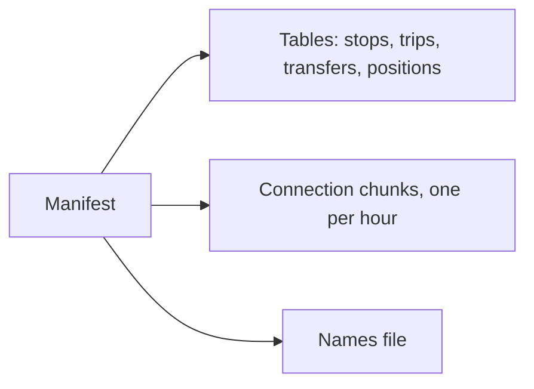

# The GBRT format

GBRT is the binary format of Gobusgo's routing snapshots: the schedule of one service date, packed so a phone can fetch it in pieces and plan trips over it with no server. This page describes format version 2. The writer is `Gobusgo.Routing.SnapshotFormat`, and the browser's reader is `assets/js/core/routing_snapshot.js`.

> *Why not just send JSON?*
>
> A day of the Puget Sound's schedule is about 675,000 connections. As JSON that is a long wait and a lot of garbage to collect. As GBRT, every connection is 24 bytes the planner reads in place by index, with no parsing step at all.

## A snapshot's files

One snapshot is six kinds of file, and a manifest that names them.



| Kind | Number | Holds |
| --- | --- | --- |
| Stops | 1 | Stop identifiers |
| Trips | 2 | Trip and route identifiers |
| Transfers | 3 | Walks between nearby stops |
| Connections | 4 | One hop of one trip, from one stop to the next |
| Positions | 5 | Each stop's latitude and longitude |

The names file (stop names, route names and colors, agency names, headsigns) is gzipped JSON rather than GBRT, so the planner's binary files carry no display text. Map geometry lives elsewhere, in the route and stop tile archive.

## Header

Every GBRT file starts with the same 16 bytes. Every number in every file is little-endian.

| Offset | Size | Field |
| --- | --- | --- |
| 0 | 4 | Magic: the ASCII bytes `GBRT` |
| 4 | 2 | Format version, `u16`: 2 |
| 6 | 2 | Kind, `u16`: 1 to 5, from the table above |
| 8 | 4 | Record count, `u32` |
| 12 | 4 | Reserved, `u32`: written as 0 |

## Records

Records follow the header back to back, with no padding. A record refers to a stop or a trip by its index in the stops or trips file, so those two files are the dictionary every other file reads through.

### Stops

Each record is a stop identifier: a `u16` byte length, then that many bytes of UTF-8. A stop's index is its position in the file, and stops are in identifier order.

### Trips

Each record is a trip identifier and its route identifier, each a `u16` length and UTF-8 bytes, then a `u8` service day offset: 0 for a trip of this date, 1 for a trip of the previous date still running after midnight. Records are ordered by offset, then identifier, so the same trip identifier can appear twice, once per offset, as two separate runs.

### Transfers

Each record is 12 bytes, ordered by from stop, then to stop.

| Size | Field |
| --- | --- |
| `u32` | From stop index |
| `u32` | To stop index |
| `u32` | Walking time in seconds |

### Connections

Each record is 24 bytes, ordered by departure, then arrival, trip, and sequence.

| Size | Field |
| --- | --- |
| `i32` | Departure, in seconds from the start of the service day |
| `i32` | Arrival, in seconds from the start of the service day |
| `u32` | Departure stop index |
| `u32` | Arrival stop index |
| `u32` | Trip index |
| `u16` | Sequence: the hop's position in the whole trip |
| `u8` | Flags: bit 0 set where riders may board at the departure stop, bit 1 where they may alight at the arrival stop |
| `u8` | Zero |

Times are signed and can pass 86,400, because a trip that runs past midnight keeps counting from the day it started on. A previous date's trip has its times moved onto this date's clock, and only its connections departing at or after this date's start are kept, so its first kept connection can have a sequence above 0.

### Positions

Each record is 8 bytes, one per stop, in the order of the stops file: an `i32` latitude and an `i32` longitude in millionths of a degree. A stop with no known position has -2,147,483,648, the `i32` minimum, on both axes.

A millionth of a degree is about a tenth of a meter, three orders of magnitude finer than the 400-meter walking radius, and whole numbers decode to exactly the same value in Elixir and JavaScript.

## Worked example

The transfers fixture in `test/fixtures/routing/v2/transfers.bin` holds two walks of 95 seconds, between stop 0 and stop 2, one in each direction:

```text
47 42 52 54  02 00  03 00  02 00 00 00  00 00 00 00   GBRT, version 2, kind 3, 2 records, reserved
00 00 00 00  02 00 00 00  5f 00 00 00                 stop 0 -> stop 2, 95 s
02 00 00 00  00 00 00 00  5f 00 00 00                 stop 2 -> stop 0, 95 s
```

## The manifest

`GET /api/routing/manifest` answers the manifest: a `formatVersion` and one entry per service date the server holds, in date order. `priv/openapi.json` describes it as `RoutingManifest`. Each entry carries:

- `serviceDate`, and `serviceDayStartMs`, the instant the service day starts in milliseconds since the Unix epoch. A snapshot carries no time zone: a reader converts its query time against this instant.
- `previousServiceDateIncluded`, false for the earliest date the server holds, which has no previous date to take trips from.
- `transferRules`: the minimum transfer time, the walking radius, the walking speed, and the most walks kept per stop. The browser walks from a rider's position to the first stops by the same rules.
- `files`: the stops, trips, transfers, positions, and names files, each with its `path`, `byteSize`, and `sha256`.
- `connectionChunks`: the connections cut by the hour of their departure, about 30 a day, each with its file fields, `departureSMin`, `departureSMax`, and `count`.

A file's name holds the SHA-256 of its contents, so its address never holds other bytes, and a browser caches it for a year. The planner fetches the four tables first, then the chunks from its departure onward, and stops once a chunk departs after its cutoff. [How the planner reads them](algorithms.md#trip-planning).

## Reading safely

A reader refuses a file rather than guess at it, and returns the reason as a value:

| Reason | When |
| --- | --- |
| `invalidHeader` | A file shorter than 16 bytes, wrong magic, or a kind other than the one asked for |
| `unsupportedVersion` | A format version other than 2 |
| `invalidLength` | Records that run past the end of the file or stop short of it |
| `invalidText` | An identifier that is not valid UTF-8 |
| `invalidPosition` | A latitude past ±90 degrees, a longitude past ±180, or a position unknown on one axis only |

The planner also refuses a file whose size differs from the manifest's `byteSize`.

## Changing the format

A change to any kind's layout raises the format version for every kind, writes new shared fixtures in a directory beside `test/fixtures/routing/v2/` named for the new version, and keeps the old ones while a reader of the old version exists. Version 2 added the positions file and changed nothing else; version 1 is no longer read anywhere, and the paths of every file changed with the version, so an offline bundle saved under version 1 is fetched again.

The Elixir tests check that the fixture records encode to the fixture files byte for byte, and the conformance suite's `tools/conformance/tests/routing_snapshot.test.mjs` checks that each implementation of the reader decodes the same files to `expected.json`.
